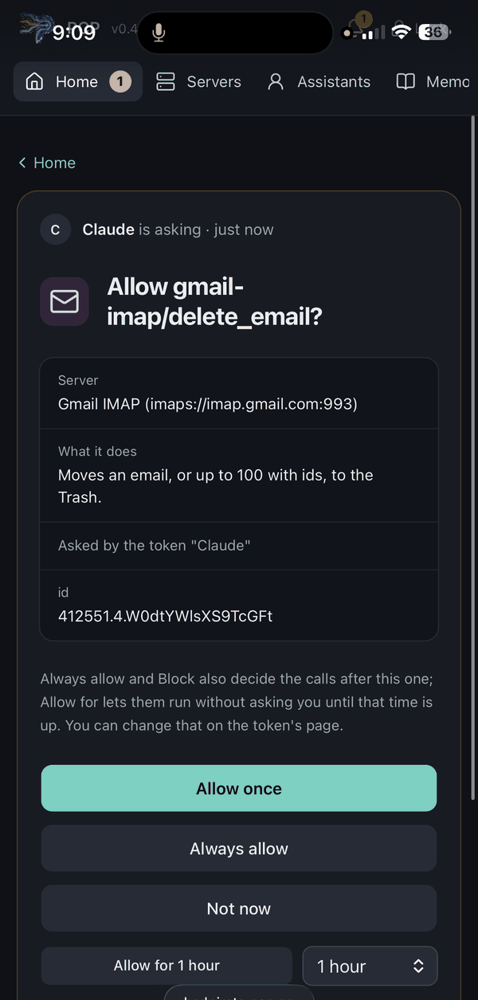
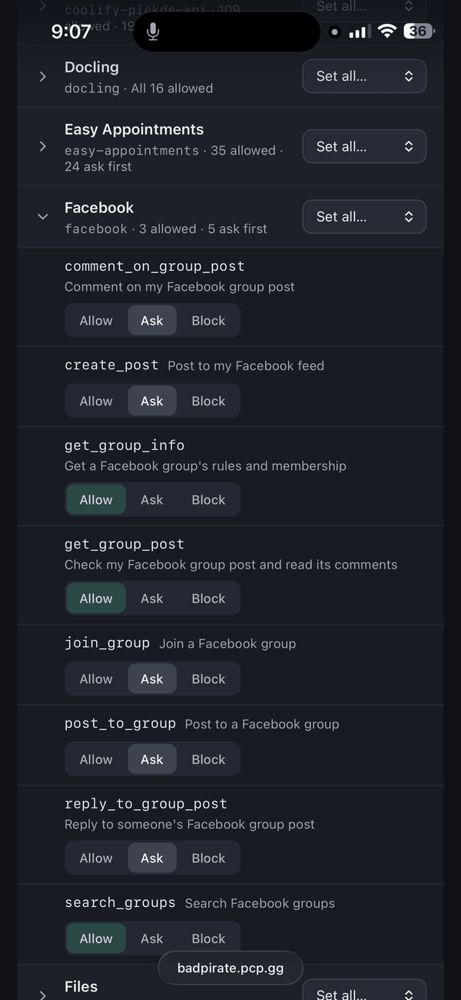
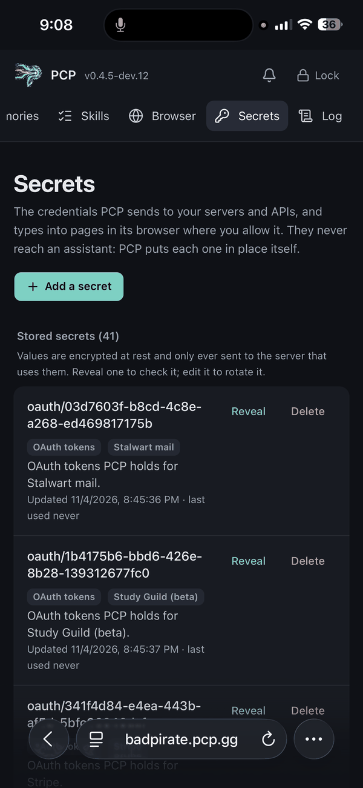
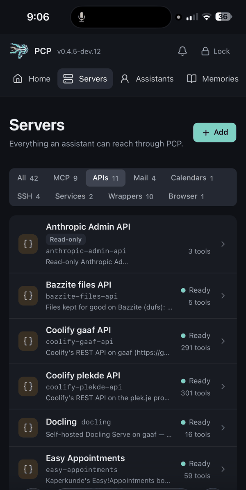
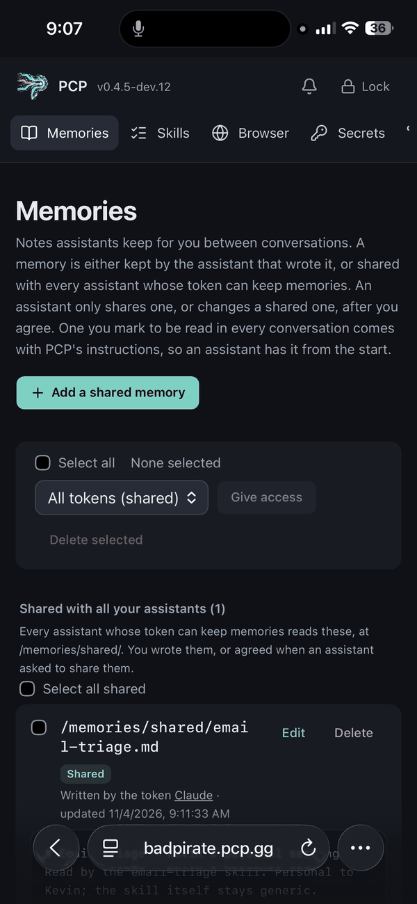

<p align="center">
  
</p>

<h1 align="center">PCP - Primary Control Provider</h1>

<p align="center">
  <strong>All the capabilities, with control.</strong><br>
  A self-hosted gateway between your AI assistant and everything it works with.<br>Your keys, your rules, your machine.
</p>

<p align="center">
  <a href="LICENSE"></a>
  
  
</p>

<p align="center">
  <a href="#quick-start">Quick start</a> ·
  <a href="docs/install.md">Install guide</a> ·
  <a href="docs/using-pcp.md">Using PCP</a> ·
  <a href="ARCHITECTURE.md">Architecture</a> ·
  <a href="CHANGELOG.md">Changelog</a> ·
  <a href="CONTRIBUTING.md">Contributing</a> ·
  <a href="SECURITY.md">Security</a>
</p>

---

PCP sits between your AI assistant and everything it works with. The assistant
gets the capabilities; PCP keeps the credentials, the permissions and the final
say. Because your setup lives in PCP and not in one provider's features, you can
switch assistants whenever you like.

It's also built to grow from your phone. An assistant can propose an API
endpoint, write a wrapper or launch a service, and nothing goes live until you
approve it.

<table>
  <tr>
    <td></td>
    <td></td>
    <td></td>
    <td></td>
    <td></td>
  </tr>
  <tr>
    <td align="center">Approve risky actions from your phone</td>
    <td align="center">Allow, ask or block, per tool</td>
    <td align="center">Secrets never reach the AI</td>
    <td align="center">Everything in one place</td>
    <td align="center">Memories that move with you</td>
  </tr>
</table>

## What it does

- **One endpoint for everything.** MCP servers, OpenAPI APIs, mail (JMAP or
  IMAP), calendars (CalDAV, iCloud included) and SSH hosts sit behind one MCP
  endpoint, with seven tools: assistants find tools with `search` and run
  them with an `execute` per tier, instead of loading every definition.
- **Allow, ask or block, per tool.** Requests that ask come to your phone:
  allow once, always or for an hour, or block.
- **Secrets never reach the AI.** They're encrypted at rest with a key the
  server doesn't hold, and PCP adds them to calls itself, OAuth sign-ins included.
- **A browser with your sign-ins.** Assistants can browse, click and fill in
  forms in a Chromium on your machine. You can watch live and take over for a
  CAPTCHA, and PCP types passwords without the assistant seeing them.
- **Wrappers and services.** Assistants write task-shaped tools on top of what
  you already have, or run container images as managed services on your hosts.
- **Files in and out.** Upload links work from your phone, and tools pass
  files to each other as handles, so the bytes never go through the model.
- **Programs.** Short programs (`run_read`, `run_write`, `run_destructive`) run inside PCP to call tools and trim large
  results before they reach the assistant.
- **Skills and memories** are shared across all your assistants.
- **Take it with you.** Export everything to one encrypted file and restore
  it anywhere. Tokens keep working.
- **Reachable from anywhere.** An optional free pcp.gg subdomain needs no open
  ports, and TLS ends on your machine.

## The hard part

Self-hosting is still harder than signing up for a SaaS, and making it
approachable is PCP's main focus: desktop apps, a one-line Linux install,
nothing to configure, and pcp.gg for reaching home. A hosted gateway would be
easier, but it would put your keys back in someone else's cloud.

## Quick start

1. **Install.** Use the app for
   [Mac (Apple silicon)](https://github.com/kaperkunde/pcp/releases/latest/download/PCP-mac-arm64.dmg),
   [Mac (Intel)](https://github.com/kaperkunde/pcp/releases/latest/download/PCP-mac-x64.dmg) or
   [Windows](https://github.com/kaperkunde/pcp/releases/latest/download/PCP-windows-x64.exe).
   On Linux with Docker or Podman, run
   `curl -fsSL https://raw.githubusercontent.com/kaperkunde/pcp/main/install.sh | sh`
2. **Set up.** Open http://localhost:3000 (or the address the installer
   prints), choose a password, and save the **recovery key** in a password
   manager. It's shown only once.
3. **Create a token** under **API tokens**.
4. **Connect an assistant on the same computer:**

   ```bash
   claude mcp add --transport http pcp http://localhost:3000/mcp \
     --header "Authorization: Bearer pcp_…"
   ```

5. **Make it reachable for hosted assistants.** Claude on the web, desktop or
   phone connects from the provider's cloud, so it can't reach `localhost`
   or a PCP behind your router. Either get a free **pcp.gg** address (no open
   ports, and TLS ends on your machine) or set up your own route: a VPS, a port
   forward with your own domain and HTTPS, or a tunnel. Then add
   `https://<your address>/mcp` as a custom connector.

Then add your servers, APIs, mail and calendars under **Servers**, or ask your
assistant to find one and propose it.

## Learn more

- [Install guide](docs/install.md): desktop apps, Linux servers, running
  without Docker, updates, backups and uninstalling
- [Using PCP](docs/using-pcp.md): servers, APIs, mail, calendars, SSH, the
  browser, wrappers, services, tokens and permissions in detail
- [How it is secured](docs/security-model.md), plus [ARCHITECTURE.md](ARCHITECTURE.md)
  and [SECURITY.md](SECURITY.md)
- [CHANGELOG.md](CHANGELOG.md): what changed in each release
- [CONTRIBUTING.md](CONTRIBUTING.md) for development, and [CLAUDE.md](CLAUDE.md) for AI agents working on the code

## Licence

MIT
